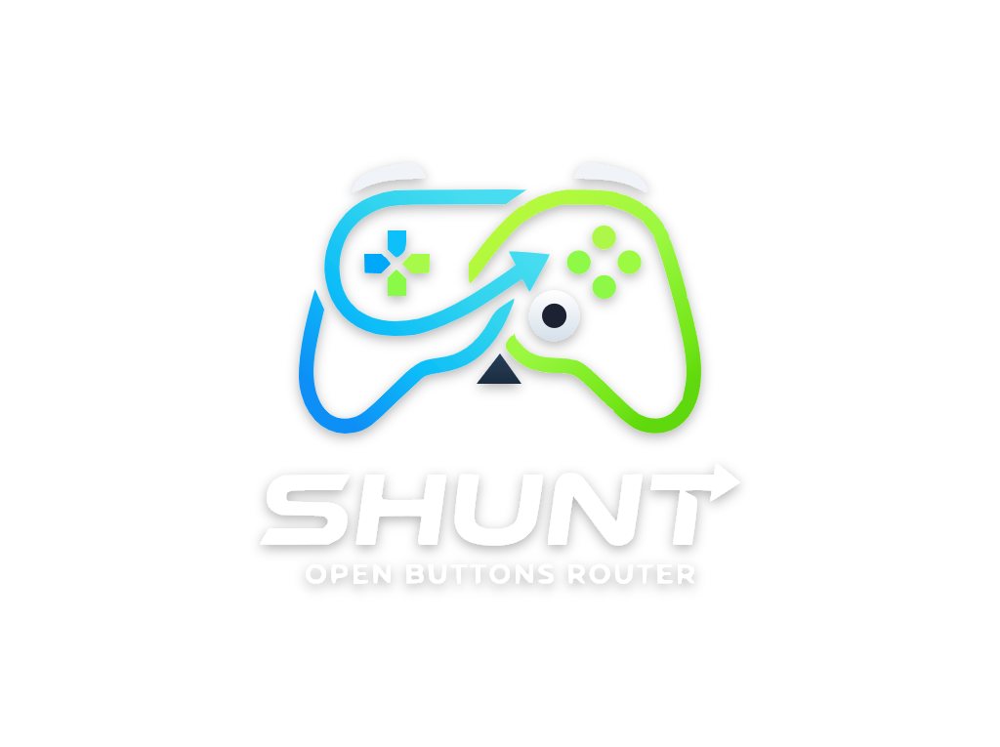
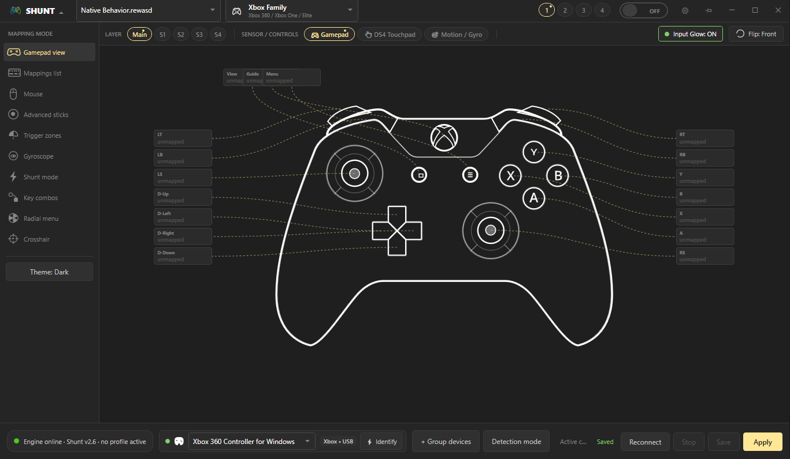
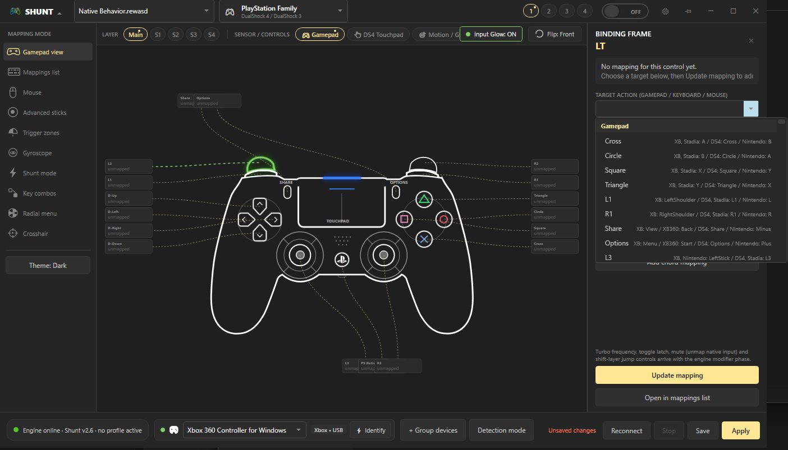
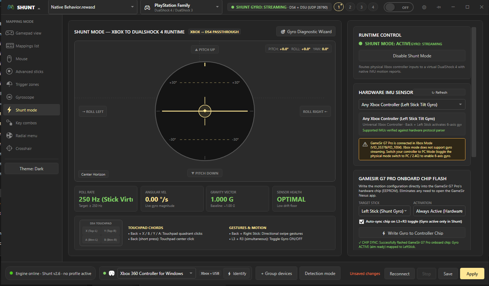

<p align="center">
  
</p>

<p align="center">
  <strong>High-performance, open-source gamepad remapping, virtual controller emulation, and hardware-accelerated button routing engine.</strong>
</p>

<p align="center">
  
  
  
  
  
</p>

---

## 🎮 Overview

<table>
  <tr>
    <td width="140" align="center" valign="middle">
      
    </td>
    <td>
      <strong>SHUNT (Open Buttons Router)</strong> is an extensible, ultra-low-latency input remapping and virtual device engine built for PC gaming, PlayStation 4 emulation (e.g. <strong>ShadPS4</strong>), and competitive controller tuning. Designed with full backward compatibility for <code>.rewasd</code> profiles, it provides complete granular control over gamepads, keyboards, mice, virtual DualShock 4 motion telemetry, and direct onboard microcontroller chip programming.
    </td>
  </tr>
</table>

---

## 📸 Screenshots & Interface

<p align="center">
  <strong>Interactive Hardware Canvas & Controller Visualizer</strong><br/>
  
</p>

<p align="center">
  <strong>Dynamic Action Remapping, Shift Layers & PlayStation Binding Frame</strong><br/>
  
</p>

<p align="center">
  <strong>Shunt Mode: Real-time 3D Gimbal Horizon, DualShock 4 Gyro Telemetry & Chip Flasher</strong><br/>
  
</p>

---

## ✨ Features

### ⚡ Shunt Mode: Xbox-to-DualShock 4 Runtime & Motion Engine
- **Hardware Gyro for ShadPS4 & PC Titles**: Converts physical controller motion or stick deflections into authentic 6-axis Sony PlayStation DualShock 4 motion telemetry (`DS4_REPORT_EX` offsets 12..23) and high-frequency UDP DSU packets (`127.0.0.1:26760`).
- **Dynamic L3 + R3 Gyro Gating**: Toggle motion aiming instantly with a simultaneous `L3 + R3` thumbstick click. Sub-40ms chord resolution ensures individual thumb clicks pass through cleanly when not pressed together.
- **Stick Suppression (Anti-Walk Aiming)**: Automatically locks the virtual left/right stick to dead center while gyro aiming is active, eliminating character drift or unwanted sprinting during precision aiming.
- **Universal Xbox Gyro**: Tilt aiming enabled for any standard Xbox controller using `Back + Left Stick` directional tilting.
- **DS4 Touchpad Gesture Chords**: Full DualShock 4 touchpad emulation mapped to Xbox controls:
  - `Back + X` / `B` / `Y` / `A`: Touchpad Left, Right, Top, and Bottom quadrant clicks.
  - `Back` (tap): Touchpad center click.
  - `Back + Right Stick`: Directional touch swipe gestures (`Up`, `Down`, `Left`, `Right`).

### 💾 Direct GameSir G7 Pro Onboard Chip Flasher (`GameSirG7ProChipWriter`)
- **Zero Third-Party App Dependency**: Directly programs the GameSir G7 Pro hardware microcontroller (MCU EEPROM) over USB GIP protocol (`D4XGaming.Devices.dll`).
- **Automatic Chip Sync on L3+R3**:
  - `L3+R3` Gyro Enabled: Automatically flashes `0x07` (`alwaysActive: true`) to offset `0x19D` on the controller chip.
  - `L3+R3` Gyro Disabled: Automatically flashes `0x00` (`alwaysActive: false`), restoring clean standard stick movement on the hardware level.
  - Auto-restores chip defaults when exiting Shunt Mode.

### 🎯 Pro Gamepad Remapping & Engine Features
- **Virtual Controller Emulation**: Low-overhead Xbox 360 and DualShock 4 controller emulation powered by the ViGEm bus.
- **Multi-Layer Shift Modifiers**: Configure main mapping layers alongside S1, S2, S3, S4 shift layers, toggle latches, turbo fires, and double-press actions.
- **Stick & Trigger Curves**: Fine-tune deadzones, anti-deadzones, linear/exponential/custom response curves, and physical trigger zones.
- **Cemuhook DSU Motion Protocol**: Built-in UDP 26760 server streaming 250Hz accelerometer and gyroscope telemetry directly to emulators (ShadPS4, Cemu, Citra, Dolphin).
- **Physical Device Cloaking**: Integrated HidHide support to cloak the physical gamepad and avoid double-input issues in Windows games.
- **Native `.rewasd` Support**: Load, validate, compile, and export `.rewasd` XML profile documents.
- **Refined Charcoal & Gold UI**: Premium dark theme interface matching the reWASD aesthetic with high-contrast readable controls.

---

## 🏗️ Architecture

The solution is divided into modular, decoupled projects:

```text
Shunt.sln
├── src/
│   ├── Shunt.Core/        # Core models, interfaces, HID enumerations, and contract types
│   ├── Shunt.Profiles/    # Profile serializer, validator, and .rewasd schema engine
│   ├── Shunt.Engine/      # Input pipeline, device polling, Shunt Mode, and chip writer
│   │   └── Hardware/      # GameSir G7 Pro MCU flasher, HID native readers, PnP discovery
│   ├── Shunt.Emulation/   # ViGEm virtual DS4/360 client and Cemuhook DSU UDP server
│   ├── Shunt.UI/          # Modern WPF desktop interface, 3D horizon gimbal, and tuners
│   └── Shunt.CLI/         # Command-line driver and background service runner
├── tests/
│   └── Shunt.Tests/       # Unit and integration test suite (389 tests, 100% passing)
└── assets/                # Logos, icons, branding assets, and screenshots
    └── images/            # High-resolution application screenshots
```

---

## 🚀 Getting Started

### Prerequisites

- [Windows 10 / 11 (64-bit)](https://www.microsoft.com/windows)
- [.NET 8.0 SDK](https://dotnet.microsoft.com/download/dotnet/8.0)
- [ViGEmBus Driver](https://github.com/nefarius/ViGEmBus/releases) (required for virtual controller emulation)
- *(Optional)* [HidHide Driver](https://github.com/nefarius/HidHide/releases) (for physical controller cloaking)

### Build and Run

1. **Clone the repository:**
   ```bash
   git clone https://github.com/hcn1z1/shunt.git
   cd shunt
   ```

2. **Build the complete solution:**
   ```bash
   dotnet build Shunt.sln -c Release
   ```

3. **Launch the Shunt UI:**
   ```bash
   dotnet run --project src/Shunt.UI -c Release
   ```

4. **Execute all unit & integration tests:**
   ```bash
   dotnet test tests/Shunt.Tests/Shunt.Tests.csproj
   ```

---

## 🎮 Shunt Mode Controls Quick Reference

| Action | Control Chord | Function |
| :--- | :--- | :--- |
| **Toggle Gyro ON / OFF** | `L3 + R3` (Simultaneous click) | Toggles 6-axis gyro streaming & auto-syncs controller chip |
| **Virtual Gyro Tilt** | `Back + Left Stick` (Direction) | Tilts 6-axis virtual gyro; suppresses left stick walking |
| **Touchpad Quadrants** | `Back + X / B / Y / A` | Left, Right, Top, and Bottom DualShock 4 touchpad clicks |
| **Touchpad Center Tap** | `Back` (Release tap) | DualShock 4 touchpad center click |
| **Touchpad Directional Swipes** | `Back + Right Stick` (Flick) | Synthesizes continuous touch swipe gestures |

---

## 🎨 Brand Assets

All branding files and icons are organized in [`assets/`](assets/):

| Asset | Format | Location | Description |
| :--- | :--- | :--- | :--- |
| **Full Logo** | PNG / SVG | [assets/logo.png](assets/logo.png) | High-res full branding logo |
| **Transparent Logo** | PNG / SVG | [assets/logo-transparent.png](assets/logo-transparent.png) | Vector & transparent logo mark |
| **App Icon** | PNG / SVG | [assets/icon.png](assets/icon.png) | 512×512 squircle controller icon |
| **Windows Icon** | ICO | [assets/icon.ico](assets/icon.ico) | Multi-resolution executable icon (16px to 256px) |
| **Screenshots** | PNG | [assets/images/](assets/images/) | High-resolution UI captures |

---

## 📄 License

This project is licensed under the [MIT License](LICENSE).
