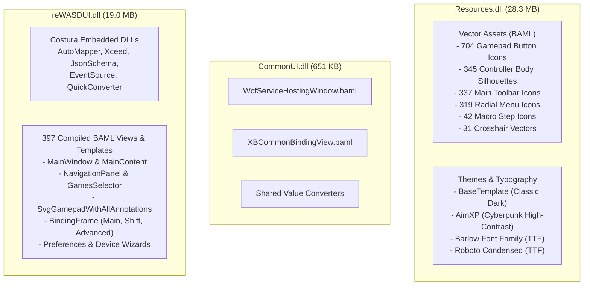
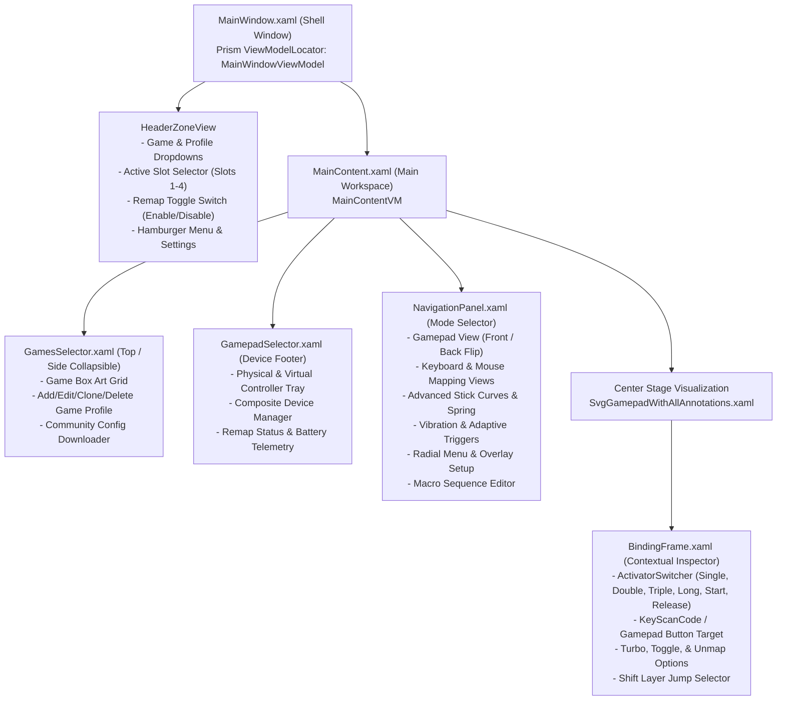
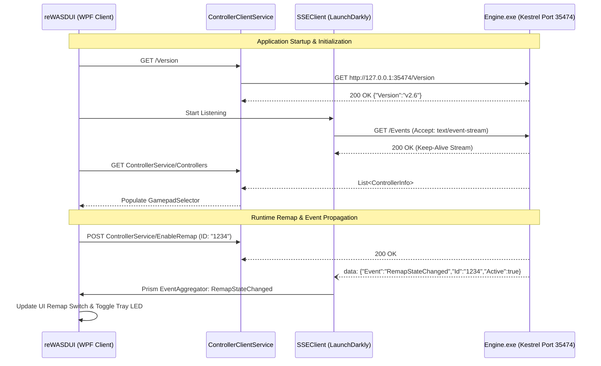
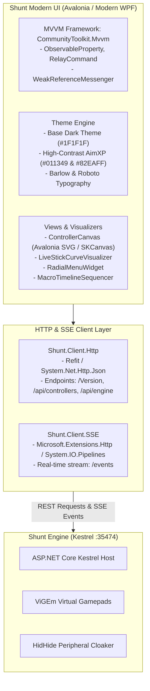

# Comprehensive UI/UX Reverse-Engineering Analysis Report: reWASD

**Target Application:** reWASD (Disc-Soft Ltd.)  
**Version:** `9.5.0.11346` (32-bit x86 ReadyToRun, .NET 10.0 CoreCLR)  
**Target Assemblies Analyzed:**  
- `reWASDUI.dll` (SHA-256: `8c44e1269e983ca948700edb03769d06f6a05b0a36a1fab8a966097bafba067a`, 19,034,088 bytes)
- `CommonUI.dll` (SHA-256: `b679b33a02fa4d748f2c3eb9adcb7e69f84852ffcb89f53e6b5275ea285f5e27`, 651,240 bytes)
- `Resources.dll` (SHA-256: `1c69784df00259fbe9f7fa51dd1c73a8e974e532bcefe76fb6825dfa27a0fc99`, 28,308,968 bytes)
- `Common.dll` (SHA-256: `78235eef22f2b7a94d8cf01b9752b047caef263c97db0e2101fe2a4d36ef55fa`, 36,802,536 bytes)

---

## 1. Executive Summary & Architectural Overview

The user interface of reWASD is a sophisticated, highly modular Windows Presentation Foundation (WPF) desktop application built on top of **.NET 10 CoreCLR** and packaged as a 32-bit ReadyToRun PE image. The frontend leverages **Prism 8.x** with **Unity Container** for inversion of control, dynamic view navigation, region management, and loosely coupled event aggregation.

### 1.1 Key UI Architectural Findings
1. **Separation of Concerns:** The UI layer (`reWASDUI.dll`) is completely decoupled from the native kernel mapping driver (`wjl19drv.sys`) and background hardware worker (`jlserv.exe`). It communicates with the backend solely via an internal **Kestrel HTTP REST API** (listening on `127.0.0.1:35474` with fallback to `36474`) and receives real-time asynchronous push notifications via **HTTP Server-Sent Events (SSE)** at `/Events`.
2. **Embedded Third-Party Ecosystem (Costura.Fody):** `reWASDUI.dll` embeds multiple high-performance utilities inside its manifest resources:
   - `AutoMapper` (model-to-ViewModel projection)
   - `Xceed.Wpf.Toolkit` (advanced sliders, integer up/down controls, color pickers)
   - `JsonSchema.Net` & `JsonSubTypes` (polymorphic validation and deserialization of `.rewasd` v3.0 schemas)
   - `LaunchDarkly.EventSource` (robust HTTP client for consuming the `/Events` SSE stream)
   - `QuickConverter` (compiled dynamic inline XAML markup expressions)
   - `QRCoder` (mobile pairing QR generation)
   - `SimpleWiFi` (ESP32 hardware dongle Wi-Fi provisioning)
3. **Massive Vector Asset Repository (`Resources.dll`):** Contains **2,558 embedded resources** divided into 68 distinct categories, featuring full front-and-back vector silhouettes for over 50 physical controller models (Xbox, PlayStation, Nintendo Switch, Steam Deck, Flydigi, Azeron, Alpakka, etc.), 319 radial menu icons, 31 custom crosshairs, and a multi-tiered theme design system.

---

## 2. Resource Extraction & Layout Inspection

### 2.1 Embedded Resource Inventory
Within `reWASDUI.dll`, `CommonUI.dll`, and `Resources.dll`, resources are structured into compiled BAML (`.baml`), PNG bitmaps, TrueType fonts, and compressed DLLs:

### 2.2 Primary Windows & Navigation Flows

### 2.3 Window & Dialog Hierarchies

1. **`MainWindow.xaml` (Main App Shell):**
   - Base Window: Inherits from custom window base with borderless chrome, custom `WindowTitle`, and custom window control buttons (`WindowHeaderButtons`).
   - Root Container: `OverrideParentIsEnabledContainer` wrapping `MainGrid`.
   - Regions: Declares `MainContentRegion` dynamically mapped via Prism `RegionManager`.
2. **`PreferencesWindow.xaml` (Settings Center):**
   - Modal tabbed secondary window hosting:
     - `PreferencesGeneralVM`: Startup, autorun, tray behavior, update checks.
     - `PreferencesGamepadsVM`: Default gamepad type, rumble passthrough, turn-off timeout.
     - `PreferencesInputDevicesVM`: High-frequency mouse unmapping, keyboard hooks.
     - `PreferencesBlacklistVM`: HidHide physical device isolation list.
     - `PreferencesLedSettingsVM`: Custom LED color mappings per physical controller.
     - `PreferencesOverlayVM`: DirectX 11/12 overlay hooks, radial menu sizing, monitor targeting.
     - `PreferencesHttpVM`: Kestrel server port configuration (`35474` / `36474`) and token authorization.
3. **`Wizard.xaml` (`AddExternalDeviceWizard`):**
   - Multi-step wizard system controlling physical device adapters:
     - ESP32-S2 / ESP32-S3 wireless Wi-Fi and Bluetooth pairing.
     - GIMX DIY adapter flashing and serial handshake.
     - Nintendo Switch / PlayStation 4 console emulation setup.
4. **`GyroWizard.xaml` (`CalibrateGyroscope`):**
   - Real-time 3-stage gyroscope noise calibration wizard (`CalibrateGyroStart`, `CalibrateGyroAutoIsOn`, `CalibrateGyroProcessing`).

---

## 3. Component & Binding Architecture

### 3.1 MVVM Infrastructure & State Management
reWASD uses an enterprise MVVM architecture:

| Component | Implementation Class | Role |
| :--- | :--- | :--- |
| **MVVM Foundation** | `Prism.Mvvm.BindableBase` | Standard `INotifyPropertyChanged` implementation with `SetProperty` caller member attribution. |
| **Domain Base** | `Engine.NET.Base.ViewModel.BindableBase.ZBindableBase` | Base class for persistent application services and controllers. |
| **Service Awaitable** | `IServiceInitedAwaitable` | Ensures services complete asynchronous REST synchronization before UI views bind. |
| **Navigation** | `Prism.Regions.INavigationAware` | Implemented on all view models (`GamepadSelectorVM`, `KeyboardMappingViewVM`, `MaskViewVM`) to handle `OnNavigatedTo` and query parameters (`navigatePath`, `region=`, `view=`). |
| **Region Lifetime** | `Prism.Regions.IRegionMemberLifetime` | Controls whether inactive views are kept in memory (`KeepAlive = false`). |

### 3.2 Real-Time Physical Controller Interception (`KeyPressedPoller`)
A standout architectural pattern in reWASD is its real-time hardware detection in the UI:
1. When mapping controls, the UI needs to automatically highlight whichever physical button the user presses on their desk.
2. `KeyPressedPollerService` runs a high-priority background polling thread calling the endpoint `/KeyPressedPoller/` or listening on SSE events.
3. Upon detection of a physical button event, it publishes `GamepadKeyPressed` or `KeyboardKeyPressed` via Prism's `EventAggregator`.
4. The active ViewModel (`BaseControllerKeyPressedPollerVM`) receives the event and updates `AssociatedControllerButton.CurrentSelectedButton`, immediately focusing the corresponding annotation on the interactive SVG canvas.

### 3.3 HTTP REST & Server-Sent Events (SSE) Client Layer
The UI interacts with the engine via strongly typed client wrappers located in namespace `reWASDUI.Services.HttpClient`:

#### Detailed Endpoint Registry Discovered in `ControllerClientService`:
- `GET /Version`: Service protocol version check.
- `GET ControllerService/Controllers`: Enumerate all connected physical gamepads, mice, keyboards.
- `POST ControllerService/EnableRemap`: Apply virtual controller synthesis and hide physical controller.
- `POST ControllerService/DisableRemap`: Detach virtual controller and restore physical input.
- `GET ControllerService/AppliedConfigs/?slot={n}`: Retrieve active profile bytecode and mappings for slot.
- `POST ControllerService/SelectSlot`: Activate slot 1, 2, 3, or 4.
- `POST ControllerService/ClearSlot`: Reset current slot memory.
- `POST ControllerService/CalibrateHardwareGyro/` & `/CalibrateSoftwareGyro/`: Trigger IMU sensor zero-offset calculation.
- `POST ControllerService/ChangeRumbleMode/` & `SendGamepadVibration`: Trigger test haptic pulses.
- `GET /Events`: Server-Sent Events continuous telemetry stream.

---

## 4. Theme, Styling, and UX Design Breakdown

### 4.1 Design System Tokens & Color Palette
reWASD implements a sophisticated dark-mode design system with two distinct presentation themes defined in `Resources.dll`:

#### 1. Core Palette: BaseTemplate (Classic Industrial Dark)
Designed for low eye strain in dim gaming environments:
- **Canvas / Root Background:** `#1F1F1F`
- **Surface / Card Backgrounds:** `#2B2B2B`, `#303030`, `#363636`
- **Elevated Controls & GroupBoxes:** `#3E3E3E`, `#404040`
- **Borders & Dividers:** `#494949`, `#525252`
- **Text & High-Contrast Glyphs:** `#FFFFFF`, `#E2E2E2`, `#EEEEEE`, `#CACACA`
- **Muted / Disabled Elements:** `#707070`, `#868686`, `#959595`
- **Primary Brand Accent (`CreamBrush`):** Gold `#FFE795`, `#FFF1BF`, `#F6DC85`
- **Status Indicators:**
  - *Success / Remap Active:* Emerald Green `#81CF66`, `#4DC81F`
  - *Error / Conflict:* Bright Coral `#FF5555`, `#CF6679`
  - *Warning / Battery Low:* Vivid Orange `#FF6D40`, `#E8B569`
- **Multi-Shift Layer Identifiers:**
  - *Shift 1:* Pastel Apricot `#FFBE8A`
  - *Shift 2:* Lime Herb `#BCE492`
  - *Shift 3:* Pale Cyan `#A6D9DF`
  - *Shift 4:* Soft Lavender `#D2BAE8`

#### 2. Modern Palette: AimXP (Cyberpunk High-Contrast)
Introduced for esports aiming and high-speed telemetry:
- **Backgrounds:** Deep Midnight Void `#011349`, `#052142`, `#042A4A`, `#191B2B`
- **Primary Accent (`YellowBrush` override):** Electric Neon Cyan `#82EAFF`, `#62DAFF`
- **Secondary Gradient:** Electric Royal Blue `#2F9AFF` to Royal Purple `#973CFF`
- **Typography:** **Barlow** (`Barlow-Thin`, `Barlow-Regular`, `Barlow-SemiBold`, `Barlow-Black`) and **Roboto Condensed** for high-density numerical readouts.

### 4.2 Interactive Controller Visualization Canvas (`SvgGamepadWithAllAnnotations`)
The centerpiece of reWASD's user experience is its dynamic SVG controller canvas:
1. **Dynamic SVG Loading:** Rather than static bitmap screenshots, reWASD loads vector paths (`.baml` compiled from SVG) representing the exact chassis geometry of the selected controller.
2. **Interactive Hit-Testing:** Each vector button element binds to an `ICommand` that triggers selection upon mouse hover or click.
3. **Responsive Annotations (`BindingAnnotation`):**
   - Floating vector pins connect from each physical button on the gamepad image to an outer rectangular badge.
   - The badge displays:
     - The assigned target input (e.g. keyboard letter, mouse click, virtual Xbox button).
     - Activator type badge (e.g. `[2x]` for double press, `[Hold]` for long press).
     - Turbo/Toggle icons.
   - When a shift layer is selected, the entire canvas dynamically re-colors each annotation to the shift's theme color (e.g. `#FFBE8A` for Shift 1).
4. **Flip View (`ButtonFlip`):** A dedicated toggle flips the 2D controller graphic from Front to Back, exposing paddles (Xbox Elite, DualSense Edge, SCUF), back buttons, and rear switches.

### 4.3 Response Curve & Sensitivity Editors
In `views/contentzonegamepad/advancedstick/`:
- **Interactive Cubic Bezier Curve:** Renders a 2D Cartesian plane with draggable control points modifying stick deflection ($X \rightarrow Y$).
- **Live Deflection Dot (`GraphDot`):** When moving the physical stick, a real-time glowing coordinate dot moves across the curve in real time, validating deadzones, spring intensity, and acceleration curves before entering a game.

---

## 5. Clean-Room Modern UI Client Blueprint

To build a modern, high-performance, open-source client (`OpenShunt.UI`) that seamlessly replaces `reWASDUI.exe` while preserving complete interoperability with both open-source and original services, follow this architectural specification:

### 5.1 Technology Recommendations
1. **Frontend Framework:** **Avalonia UI 11** or **WPF on .NET 10**:
   - Cross-platform capability (enables running the UI on Linux / Steam Deck for mapping virtual devices).
   - High-performance hardware-accelerated Skia rendering for zero-latency stick curve graphs and 8000Hz live input visualization.
2. **MVVM Toolkit:** `CommunityToolkit.Mvvm`:
   - Replaces heavy Prism boilerplate with high-speed source generators (`[ObservableProperty]`, `[RelayCommand]`).
   - `WeakReferenceMessenger` provides zero-allocation event aggregation replacing `Prism.Events.PubSubEvent`.
3. **SVG & Vector Rendering:** `Avalonia.Svg.Skia` or `SharpVectors`:
   - Renders SVG silhouettes with arbitrary re-coloring of paths (`Fill` and `Stroke` binding).
4. **API Client:** `Refit` with `System.Net.Http.Json`:
   - Generates clean C# interfaces mapping to `/api/controllers`, `/api/games`, `/api/engine`.
   - Native `IAsyncEnumerable<SseEvent>` via .NET 10 SSE streaming for instant reactive updates.

---

## 6. Technical Provenance & Evidence Verification Index

| Component | File / Path | Binary Location / Offset | Evidence Details |
| :--- | :--- | :--- | :--- |
| **UI Framework** | `C:\Program Files\reWASD\reWASDUI.dll` | ReadyToRun PE header `0x1CFE4` | TargetFramework `.NETCoreApp,Version=v10.0`, Assembly Version `9.5.0.11346` |
| **MVVM Shell** | `reWASDUI.dll` -> `reWASDUI.Views.MainWindow` | BAML Token `reWASDUI.Views.MainWindow` | Uses Prism `ViewModelLocator.AutoWireViewModel="True"` and `RegionManager` |
| **REST API Base** | `reWASDUI.dll` -> `reWASDUI.Services.HttpClient` | TypeDef Token `0x0200015F` | Implements `BaseHttpClientService` targeting port `35474` |
| **SSE Event Stream**| `reWASDUI.dll` -> `reWASDUI.Services.SSEClient` | TypeDef Token `0x02000155` | Consumes `/Events` using `LaunchDarkly.EventSource` |
| **Key Detection** | `reWASDUI.dll` -> `KeyPressedPollerService` | TypeDef Token `0x02000153` | Real-time input hooking via `/KeyPressedPoller/` |
| **Themes & Fonts** | `C:\Program Files\reWASD\Resources.dll` | `themes/basetemplate/colors.baml` | 68 categories, 2,558 assets, Barlow fonts, full color tokens |
| **Schema Validation**| `reWASDUI.dll` -> Manifest Resource | Resource Offset `2728826` | `ConfigJSONSchema_3.0.json` (Draft-07, 74,151 bytes) |
